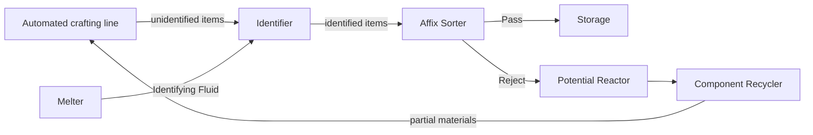

# PRD: Identifier and Affix Sorter

> Design requirements, not a release status report. See [Current Implementation](../reference/current-implementation.md) and the [player wiki](https://c-pettersson.github.io/rngtech/) for current behavior.

PRD status: Draft

Implementation status: Planned

Release: TBD

Last updated: 2026-11-01

## Summary

Stage 8 adds a native chain that sorts automatically crafted Gear by its rolls. An automated line crafts unidentified items. The **Identifier** identifies them, paid in FE and **Identifying Fluid** from the Melter. The **Affix Sorter** then checks each item against an ordered list of player-written rules, like the loot filter in Last Epoch. A matching item leaves through the Pass outputs and goes to storage. Everything else leaves through the Reject outputs and goes to recycling.

The chain is an endgame sink. Each pass through it costs crafting materials, fluid, and FE that grows faster than the rule list. The recycler gives back only part of what a rejected item cost.

## Design Change: Automated Identification

Today identification is a player step: a crafting grid, placing a machine, or installing a part (#248). A machine crafter's output stays unidentified. On 2026-10-18 identification was kept a human step so that rolling could not be automated. This PRD reverses that rule for Stage 8 only:

- The Identifier is the one machine that identifies items. It is Stage 8, and every item costs Identifying Fluid and FE.
- Identification by hand stays free and unchanged. The Identifier sells automation, not better rolls.
- Players still build the line, balance its throughput, and choose where rejected items go. No machine plans crafts, keeps stock, or reads a global inventory.

### Closing Free Automated Identification

Without this change, other paths would identify items for free and leave the Identifier no role. #248 identifies an item on any real insert into a Gear slot, so a side-insertable Gear slot that automation can also empty, such as a Battery Cell slot, works as a free Identifier. Machine placers from other mods identify machines by placing them.

- Installing a part identifies it only when a player puts it in: by hand, by Shift-click, or through the Tool Bench. Inserts from cables, hoppers, and other automation leave it unidentified.
- Placing a machine identifies it only when a player places it. A machine placed by a fake player or another mod's placer stays unidentified. How an unidentified placed block behaves is settled in phase 1.
- Identification in the crafting grid stays as it is. The vanilla Crafter does not identify today, and it stays that way.

## References

- [Rarity and Affixes](https://c-pettersson.github.io/rngtech/rarity-and-affixes/), including identification, affix tiers, Quality, and Annealed items
- [Affix Generation](../systems/affix-generation.md)
- [Advanced Item Filter](https://c-pettersson.github.io/rngtech/universal-cable/#advanced-item-filter), the existing filter item
- [Melter](https://c-pettersson.github.io/rngtech/melter/), [Component Recycler](https://c-pettersson.github.io/rngtech/component-recycler/), [Potential Reactor](https://c-pettersson.github.io/rngtech/potential-reactor/)
- [Machine Guidelines](../reference/machine-guidelines.md) and [Machine GUI Design](../reference/machine-gui-design.md)
- Last Epoch loot filter: an ordered rule list, where the highest matching rule decides what happens to a drop

## Goals

- A player can run a crafting line unattended and keep only the items that meet their own conditions.
- Rules can test the things players chase: affixes, affix tiers, affix count, Quality, rarity, Refinement Potential, and Unique roll quality.
- The chain consumes Stage 8 resources and FE at a rate that scales with how picky the player is.
- Every cost is visible before the player commits: per-item fluid on the Identifier, per-item FE for the current rule list on the Affix Sorter.

## Non-Goals

- No autocrafting, crafting requests, stock levels, or global inventory. See the logistics direction in [Machine Guidelines](../reference/machine-guidelines.md#automation).
- No rerolling. The Affix Sorter never changes an item. Refinement stays with the Affix Forge and Phase Array.
- No better identification. The Identifier rolls exactly as a crafting grid would, including Annealed rolls and seeded Unique rolls.
- No yield or currency. Rejected items return nothing extra from the recycler or reactor.
- No replacement for the Advanced Item Filter on cables. That item stays the cheap filter for identity, rarity, stage, and Stability.

## Player Flow

1. The player builds a line that crafts one kind of item, such as an Exotic Servo, and feeds it the materials.
2. Unidentified items flow into the Identifier. It draws Identifying Fluid and FE for each item.
3. Identified items flow into the Affix Sorter. The player has written rules there, for example "Rare or better, with Processing Speed Tier 6 or higher".
4. Matches leave through the Pass faces into a chest. Everything else leaves through the Reject faces.
5. Rejected items go to a Potential Reactor to recover FE from their rolls, then to a Component Recycler for part of their materials. The reactor step is optional.

## Identifying Fluid

Resource id: `rngtech:identifying_fluid` (draft)

- Made in the Melter at Stage 8. The recipe needs Processing Level 8 and Stage 8 heat.
- Gated by RNGTech's own challenges, never vanilla loot. Draft recipe: a Stage 8 calibrated logic component and an Exotic dust, melted into Ender Slurry. The calibration is the gate; the dust and slurry are the bulk cost.
- It has one use, the Identifier, so the per-item cost reads directly as the cost of automating identification.
- It ships as a bucket, flows in Universal Cables, and can be purged like other process fluids.

## Identifier

Resource id: `rngtech:identifier` (draft). Stage 8, one chassis.

### Behavior

- Input: unidentified items. Identified items, stripped items, and items that never roll are refused at insertion, so a mixed stream never jams the machine.
- Each item costs Identifying Fluid and FE. Both grow with the item's stage, so a Stage 2 part costs far less than a Stage 8 one. The Process tab shows the next item's cost on hover.
- Identification uses the same roll as the crafting grid (`CraftedTraitOutputs.rollIfMissing`). Seeded rolls keep their seed, Annealed rolls twice for RP, and Uniques roll their ranges. Uniques are accepted: their rolls are seeded when they drop, so the result is the one a crafting grid would give.
- One item per cycle. Stacked unidentified items are taken one at a time.
- Output waits in an output buffer. A full buffer stops the machine and voids nothing.
- It follows the machine screen rules: Process, Gear, Stats, Refinement, Mastery, and Orders tabs, graphical state, and exact values in hover text.
- It is a processing machine, so it joins the shared Machine Mastery graph with its own start and takes Work Orders. Mastery XP comes per identified item. A Work Order objective counts identified items, weighted by item stage so cheap Stage 1 parts cannot finish a job.

### Gear

| Slot | Required | Role |
|---|---|---|
| Fluid Pump | Yes | Draws Identifying Fluid. Any stage fits. Pump stage could set the tank size. |
| Servo | Yes | Sets identification speed. Any stage fits. |
| Battery Cell | No | Standard energy buffer and the no-cell penalty from the energy model. |

### Rolls

Affix-eligible. Draft rolls: Processing Speed, reduced Energy Usage, reduced Identifying Fluid per item, and Fluid Capacity. No roll touches the identified item's rarity, affixes, or RP.

## Affix Sorter

Resource id: `rngtech:affix_sorter` (draft). Stage 8, one chassis.

### Rules

A rule has an action, a set of conditions, an on/off toggle, and an optional redstone pulse. An item matches a rule when it meets every condition in that rule.

| Condition | Matches | Last Epoch analogue |
|---|---|---|
| Item | Sample items, an item tag, or a Gear or machine family | Item type and subtype |
| Stage | A stage range | Level |
| Rarity | Any of the selected rarities | Rarity |
| Affixes | Pick affixes from the list, each with a minimum tier, and ask for at least N of them | Affix condition with minimum count |
| Quality | The item's total affix tier is at least a value | Combined affix tier |
| Refinement Potential | RP is at least a value | Legendary Potential |
| Unique | Roll quality is at least a value | Weaver's Will |
| State | Corrupted or intact, Annealed, Mirrored | — |

The affix list shows only affixes that can roll on the items the rule's Item condition allows. A rule with no Item condition shows every affix.

### Evaluation

- Rules run from the top. The first rule that matches decides the item's route.
- An item that matches no rule takes the default route. The default is Reject, and the player can change it.
- A rule's action is Pass or Reject. A Reject rule above a Pass rule lets the player carve exceptions, for example "reject Corrupted" above "pass Rare".
- Disabled rules are skipped and cost no FE.
- Rule Capacity limits enabled rules, not stored ones. The player can keep more rules in the list and switch them on as capacity allows.

### Outputs

- Two output buffers: Pass and Reject.
- Each face is set to Pass, Reject, or none. Cables and hoppers pull from the face. The machine never pushes, so the player can place the two routes anywhere.
- When the buffer an item needs is full, the machine stops. It never reroutes or voids an item.
- A rule with its pulse turned on sends a short redstone pulse when it decides an item's route. The pulse leaves every face that is not set to Pass or Reject. A player can use it to stop the crafting line on a hit or to ring a bell. It is a local signal, not a stock count.
- Unidentified items are not accepted. Without that rule, a line that skips the Identifier would sort items with no rolls.

### Energy

Each inspected item costs FE that grows faster than the number of active rules:

`FE per item = E0 × n^1.5`, where `n` is the number of enabled rules (at least 1).

| Enabled rules | Cost |
|---:|---:|
| 1 | 1× |
| 5 | 11× |
| 10 | 32× |
| 20 | 89× |

`E0` is set by the processing balance simulation against Stage 8 generation. The Process tab shows the current per-item cost on hover, and the rule screen shows how the cost changes as rules are enabled. At the full 20-rule capacity, an item costs about 89× a one-rule list.

### Gear

| Slot | Required | Role |
|---|---|---|
| Rule Core (new, draft name) | Yes | Sets Rule Capacity, the most enabled rules: 8 before rolls. Stage 8 Exotic. |
| Servo | No | Inspection speed. |
| Battery Cell | No | Standard energy buffer and the no-cell penalty. |

No existing part fits the required slot. A Control Board rolls calibration stats the Affix Sorter cannot read, and a Recovery Filter is a recycler and reactor gate.

### Rolls

Affix-eligible, on the machine and the Rule Core. Draft rolls: +Rule Capacity (the chase roll, up to +12 in total across the machine and the Rule Core, for at most 20 enabled rules), reduced Energy Usage, and Processing Speed. Reduced Energy Usage divides the whole curve, so it never makes extra rules free.

### Screen

The rule editor is an exception to the low-text rule in [Machine GUI Design](../reference/machine-gui-design.md). It needs names and numbers to build conditions. The exception covers only the rule list and rule editor. The other tabs follow the normal rules.

- Left: the ordered rule list, with drag to reorder, an on/off toggle, and the action shown by colour and shape.
- Right: the selected rule's conditions, added from a menu.
- Bottom: rule count against Rule Capacity, and the FE per item.

Rules save on the block and stay with it when it is broken.

### Rule Card

Resource id: `rngtech:rule_card` (draft). A craftable item that copies a rule list from one Affix Sorter to another.

- Use it on a sorter to copy that sorter's rules onto the card. Use it on another sorter to write them there.
- Writing replaces the target's whole list. Rules above the target's Rule Capacity arrive disabled.
- The card does not roll and is not consumed. Its tooltip shows the rule count.
- There is no clipboard text export. Players share rule lists in game.

## Loop Prevention

- Identifying Fluid has one sink and is not an input to any recipe that could make it back.
- Rejected items follow the existing reactor and recycler rules. Rarity, affixes, and RP never improve recycler returns, and the reactor's repeat-burn penalty already covers rolled items.
- `check-recipe-loops.mjs` must include the Identifying Fluid recipe. The full chain must cost more FE than the reactor pays back for fresh Stage 8 crafts.

## Risks

- **Free identification in other mods.** A mod that crafts or inserts items as a fake player could still look like a player action. Check common automation mods during the playtest.
- **Narrowing #248.** Identification on any Gear insert is on main but in no release yet, so limiting it to player inserts breaks no released world.
- **Rule screen scope.** A full affix picker with tiers is the largest screen in the mod. It needs the affix registry, eligibility by item family, and tier ranges on the client.

## Open Questions

None. The draft's questions were answered on 2026-11-01. See [Decisions](#decisions).

## Delivery Phases

1. Identifying Fluid, its Melter recipe, the Identifier with Gear, rolls, Mastery, and the standard tabs, and player-only identification on install and placement.
2. The Affix Sorter with Item, Stage, Rarity, and State conditions, Pass and Reject faces, redstone pulses, and the energy curve.
3. Affix, Quality, RP, and Unique conditions with the affix picker.
4. The Rule Core part, Rule Capacity rolls, the Rule Card, and the Identifier's Work Order objective.
5. Wiki pages, the in-game guide, quests, and the balance pass on `E0` and fluid cost.

## Test Plan

- GameTests: the Identifier refuses identified items and matches crafting-grid rolls for seeded, Annealed, and Unique stacks. It stops on a full output and on an empty tank.
- GameTests: a part a cable or hopper inserts into a Gear slot stays unidentified, and a part a player installs is identified. A machine a fake player places stays unidentified.
- GameTests: the first matching rule decides, disabled rules are skipped, the default route applies, each face exposes only its buffer, a full buffer stops the machine, and a rule with its pulse on emits redstone.
- GameTests: a Rule Card copies a list, and rules above the target's capacity arrive disabled.
- Domain checks: the energy curve, Rule Capacity limits, and every condition against fixture items.
- `npm run moddex:check` with the new fluid recipe in the loop audit.
- In game: run a full chain from a crafting line to storage and recycling. Check that the hover costs match what the machines spend.

## Acceptance Criteria

- A Stage 8 chain identifies, sorts, and routes crafted items without player input.
- The Identifier rolls exactly as identification by hand.
- Automation identifies items only through the Identifier.
- Affix Sorter FE per item follows the chosen curve and is visible before the player adds a rule.
- No item is voided, rerouted, or changed by the chain.
- `./gradlew ciCheck`, `npm run moddex:check`, `npm run repo:check`, `mkdocs build --strict`, and the GameTests pass.

## Decisions

Set by the brief, 2026-11-01:

- Three pieces: Identifying Fluid (Stage 8, Melter), the Identifier (Stage 8, affix-eligible, standard screen rules, Fluid Pump and Servo Gear), and the Affix Sorter (Stage 8, affix-eligible, rule-screen exception, required Gear).
- The Affix Sorter is expensive to craft. Its energy cost depends on the number of rules and grows faster than linearly.
- The Affix Sorter behaves like the Last Epoch loot filter.
- The chain exists to do this natively in RNGTech and to give the endgame a resource and energy sink.

Resolved 2026-11-01:

- The sorting machine is named **Affix Sorter** (brief name: Item Filter), so it does not clash with the Advanced Item Filter cable item.
- FE per checked item is `E0 × n^1.5` over enabled rules.
- Rule Capacity is 8 before rolls and up to +12 from rolls, so at most 20 enabled rules.
- Each rule can send a redstone pulse when it matches.
- Rule lists are shared with a Rule Card item. There is no clipboard export.
- The Identifier gets Machine Mastery and Work Orders. The Affix Sorter gets neither, because it runs no recipes.
- The Identifier accepts Uniques.
- Identification on install and on placement happens only for player actions. Automation identifies items only through the Identifier.
